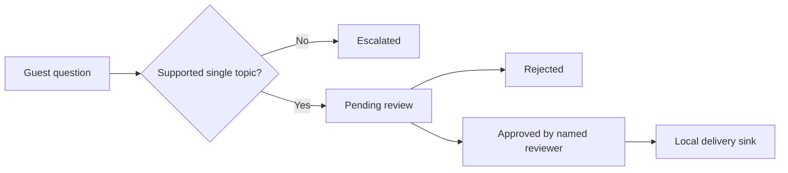

# Guest Reply Assistant

**A review-first support workflow with explicit state transitions and an audit trail.**

Python portfolio prototype for English property FAQs. Rule-based matching creates a supported draft; sensitive, ambiguous, negative, or unknown requests escalate without a draft. A named human must approve before the local send adapter can run.



## Run the complete workflow

Python 3.10+, standard library only. From the repository root:

```sh
python3 assistant.py --db /tmp/guest-demo.db submit message-1 'Is parking available?'
python3 assistant.py --db /tmp/guest-demo.db review message-1 approve --actor demo-host
python3 assistant.py --db /tmp/guest-demo.db send message-1
python3 assistant.py --db /tmp/guest-demo.db send message-1
python3 assistant.py --db /tmp/guest-demo.db submit message-2 'I need a refund'
python3 assistant.py --db /tmp/guest-demo.db status
python3 -m unittest discover -s tests -v
```

Expected: `pending → approved → sent`. Second send returns `replayed: true` without creating a second delivery. Refund request becomes `escalated`. Sending before approval, approving a rejected draft, and reusing an ID for different text are rejected. Use a new database path for a fresh demo.

## Scope and safety boundaries

This is **not an LLM agent or live Airbnb integration**. The send adapter writes only to a local SQLite table; it sends no external messages. Approval and delivery are durable, local state transitions. Reviewer names are audit labels, not authenticated identities. Real deployment needs authenticated roles, an inbox adapter, message redaction, evaluation, access control and monitoring. A real external send requires its own idempotency and reconciliation policy.

Matching is conservative but cannot understand every ambiguous request. It is English-only, keyword-based, and is not a complete safety classifier. Never enable unattended replies based on these rules. Knowledge entries must be trusted, non-sensitive facts; do not store door codes or passwords. Production integrations and LLM evaluation are future work, not claimed capabilities of this demo.

## Evidence

[Tests](tests/test_assistant.py) exercise forbidden state transitions, escalation cases, repeated inputs and delivery, and audit entries. Example property details are fictional. No customer data or production screenshots are included.
