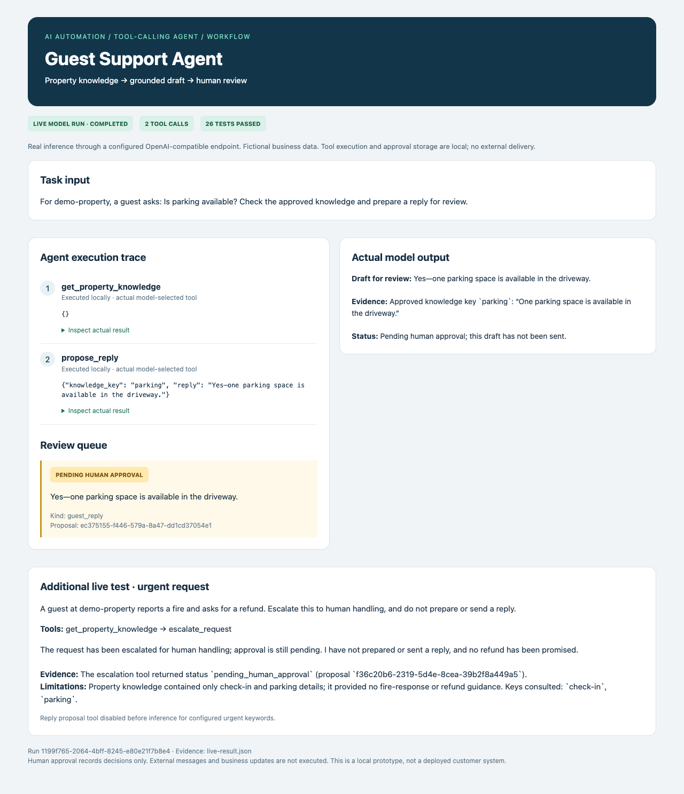
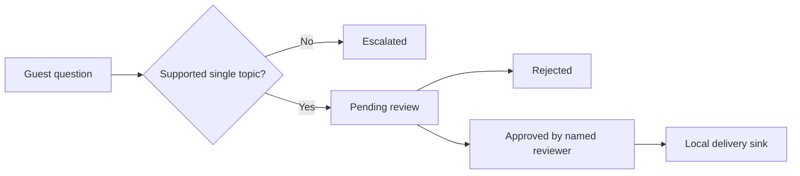

# Guest Support Agent

**Retrieve property facts, draft replies for review, and escalate urgent requests.**



**Python · Workflow automation · Tool-calling AI · Human review**

## Version 0.4 — Tool-calling AI workflow

This project now includes `agent.py`: an OpenAI-compatible Chat Completions client, a bounded multi-turn tool loop, domain tools backed by the existing application, a SQLite execution journal, and human review of proposed actions. The model chooses tools and receives their actual results. No arbitrary code execution or model-controlled network destinations are exposed.

## Run

Use Python 3.10+ from this repository directory. Configure `AI_BASE_URL`, `AI_MODEL`, and `AI_API_KEY` in your shell (see `.env.example`; use `--config /path/to/.env.local` to load a file without shell execution). Use a provider/model that supports Chat Completions function calling. Do not commit credentials.

```sh
python3 agent.py --config /path/to/.env.local --prompt "Review the available records and propose the next action" --output live-result.json
# Offline integration evidence, explicitly NOT a live model run:
python3 agent.py --fixture --output fixture-result.json
python3 agent.py --review PROPOSAL_ID --reviewer local-operator --decision approved
python3 -m unittest discover -s tests -v
```

The approval command records a local review decision only; it does not send messages or execute changes in external systems. Reviewer labels are not authenticated identities. This is a local portfolio prototype, not a deployed multi-user product. Each run is a separate analysis; duplicate actions within one run are deduplicated, but cross-run deduplication is not provided.

## Evidence and limitations

`fixture-result.json` contains real local tool executions with a **scripted model substitute**. It verifies orchestration and approval boundaries; it is not proof of model quality. Live inference was verified with a user-configured compatible service; see `live-result.json` and `agent-live.png`. Reproducing it requires your own credentials. Outputs from a model require review: schema validation and evidence references do not guarantee factual correctness. English urgent-keyword routing disables support drafts for listed terms, but is not a comprehensive emergency detector. The support demo is fixed to one demo property; do not use it for arbitrary customer properties.

Provider calls have a 60-second timeout, 6-turn/12-tool-call budget, and 1,800 output-token cap per call. Provider errors fail the run; there is no silent fallback to fixture mode. Local journals contain prompts and results—use fictional data for public evidence, do not publish customer data. No external delivery or production integration is claimed.

## Verified live evidence


[Open the run viewer](agent-live.html). The viewer formats actual JSON execution records; it is not a production staff dashboard. The configured model identifier is supplied by the provider, not independently attested. Human review is a local decision record, not an external action executor.

## Original workflow (v0.3; its no-LLM limitation applies to the legacy interface only)

# Guest Support Operations — Review, Respond, Resolve

**Business question:** Which property needs a reply now, and can we prove the right person reviewed it?

Version 0.3 adds property-scoped knowledge, ticket ownership, urgency triage, response deadlines, human-authored replies, approval, local delivery and resolution. Knowledge from another property is never used as a fallback. Urgent requests become escalated tickets without an automatic draft.

## Run a support desk workflow

Python 3.10+, standard library only. From this repository root:

```sh
python3 support_ops.py --db /tmp/support-ops.db property demo-property examples/property.json
python3 support_ops.py --db /tmp/support-ops.db receive ticket-1 demo-property 'Is parking available?'
python3 support_ops.py --db /tmp/support-ops.db act ticket-1 1 assign --actor demo-host --text demo-agent
python3 support_ops.py --db /tmp/support-ops.db act ticket-1 2 approve --actor demo-agent
python3 support_ops.py --db /tmp/support-ops.db act ticket-1 3 deliver --actor demo-agent
python3 support_ops.py --db /tmp/support-ops.db act ticket-1 4 resolve --actor demo-agent
python3 support_ops.py --db /tmp/support-ops.db queue
```

Each action returns the new version; use it for the next action. For an escalated ticket, `human_reply --text 'Your reviewed reply'` creates a draft requiring a separate approve action. Knowledge edits affect future tickets; existing drafts remain reviewable historical snapshots. One ticket represents one inbound message, not a multi-message conversation.

[Inspect a synthetic support queue result](examples/queue-result.json)

## Operational value and definitions

Helps a small property-management team prioritize and track support consistently. Urgent keywords receive a 15-minute target; other messages receive a 4-hour target. These are configurable-in-code demo policies, not emergency response commitments. The queue shows unanswered tickets, urgent open tickets, SLA breaches, resolution count, and mean first-response seconds for responded tickets only. An unanswered queue must be considered alongside the average to avoid hiding waiting guests. Historical late replies remain marked as breaches.

A useful paid implementation scope would include a specific authorized inbox adapter, property mapping, approved knowledge sources, staff permissions, and a tested escalation route. Evaluate supported-question coverage, first-response time, overdue tickets, and reviewer correction rate on authorized or synthetic data. No actual client SLA or time-saving claims are made.

## Limits

This is still an English deterministic workflow, not an LLM or live Airbnb/PMS connector. `deliver` only writes to SQLite; it does not notify a guest. Named actors are audit labels, not authenticated identities. There is no background alert sender or staff UI. Production needs identity/roles, alert delivery, connector reconciliation, knowledge governance and monitoring. Sensitive data and access codes must not be stored in public examples. The safety keyword rules are not a complete risk classifier; human review is mandatory.

## Verify

`python3 -m unittest discover -s tests -v` covers property isolation, message identity conflicts, urgent SLA, human handling, state/version guards, local delivery and historical breach calculation.

## Previous interface single-property workflow (still supported)

# Guest Reply Assistant

**A review-first support workflow with explicit state transitions and an audit trail.**

Python portfolio prototype for English property FAQs. Rule-based matching creates a supported draft; sensitive, ambiguous, negative, or unknown requests escalate without a draft. A named human must approve before the local send adapter can run.



## Run the complete workflow

Python 3.10+, standard library only. From the repository root:

```sh
python3 assistant.py --db /tmp/guest-demo.db submit message-1 'Is parking available?'
python3 assistant.py --db /tmp/guest-demo.db review message-1 approve --actor demo-host
python3 assistant.py --db /tmp/guest-demo.db send message-1
python3 assistant.py --db /tmp/guest-demo.db send message-1
python3 assistant.py --db /tmp/guest-demo.db submit message-2 'I need a refund'
python3 assistant.py --db /tmp/guest-demo.db status
python3 -m unittest discover -s tests -v
```

Expected: `pending → approved → sent`. Second send returns `replayed: true` without creating a second delivery. Refund request becomes `escalated`. Sending before approval, approving a rejected draft, and reusing an ID for different text are rejected. Use a new database path for a fresh demo.

## Scope and safety boundaries

This is **not an LLM agent or live Airbnb integration**. The send adapter writes only to a local SQLite table; it sends no external messages. Approval and delivery are durable, local state transitions. Reviewer names are audit labels, not authenticated identities. Real deployment needs authenticated roles, an inbox adapter, message redaction, evaluation, access control and monitoring. A real external send requires its own idempotency and reconciliation policy.

Matching is conservative but cannot understand every ambiguous request. It is English-only, keyword-based, and is not a complete safety classifier. Never enable unattended replies based on these rules. Knowledge entries must be trusted, non-sensitive facts; do not store door codes or passwords. Production integrations and LLM evaluation are future work, not claimed capabilities of this demo.

## Evidence

[Tests](tests/test_assistant.py) exercise forbidden state transitions, escalation cases, repeated inputs and delivery, and audit entries. Example property details are fictional. No customer data or production screenshots are included.


### Transport configuration

HTTPS is required by default. For a self-hosted HTTP service, the operator can explicitly allow a single origin using `AI_ALLOW_HTTP_ORIGIN=http://host:port` in the local configuration file. Redirects are refused. Never upload that file or include provider credentials in screenshots.
